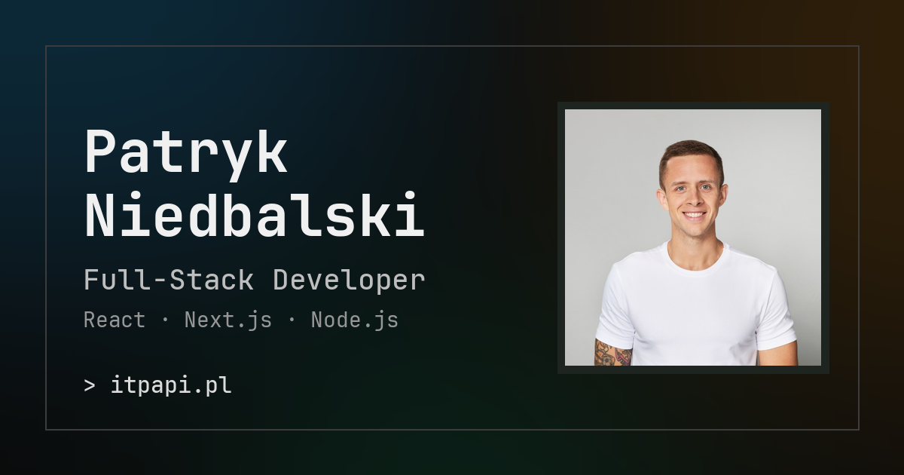

# Patryk Niedbalski · Portfolio

Source code of my personal website: **[itpapi.pl](https://itpapi.pl)**.



Full-stack developer (React, Next.js, Node.js, NestJS) based in Warsaw. The site presents my projects and services, and includes a **Showroom** (`/[locale]/showroom`) with interactive demos: landing page, dashboard, e-commerce, event page, portfolio, admin panel and a SaaS calculator.

## Stack

- [Next.js](https://nextjs.org) 16 (App Router) + React 19 + TypeScript
- [MUI](https://mui.com) 7 with a custom light/dark theme
- [next-intl](https://next-intl.dev) for Polish and English (`messages/pl.json`, `messages/en.json`)
- Components organised with Atomic Design (`src/components/atoms` → `templates`)
- SEO: metadata, Open Graph, JSON-LD, `sitemap.ts`, `robots.ts`
- Contact form via Formspree, analytics via Google Analytics

## Running locally

```bash
npm install
npm run dev     # http://localhost:3000
npm run build   # production build
npm run lint
```

## Project structure

```
src/
  app/[locale]/          # pages (home + showroom demos)
  components/            # atoms, molecules, organisms, templates
  i18n/                  # next-intl routing and request config
  theme/                 # MUI theme and theme context
messages/                # translations (pl, en)
public/                  # images, video, CV
docs/                    # prompts and task contracts used for AI-assisted development
```

## Contact

- Website: [itpapi.pl](https://itpapi.pl)
- GitHub: [@NiedbalskiPatryk](https://github.com/NiedbalskiPatryk)
